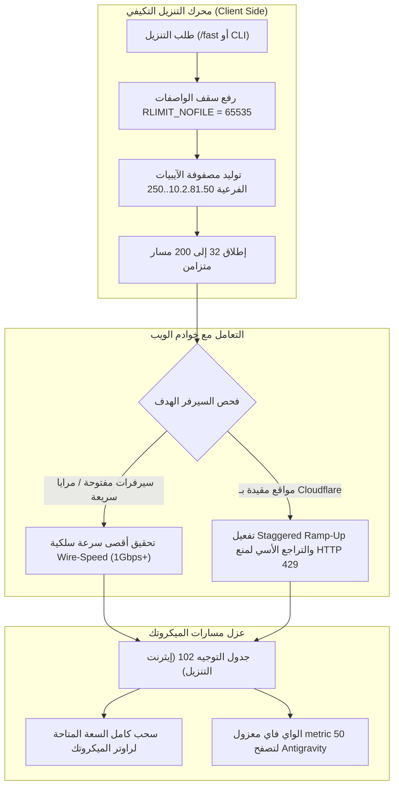

# 🚀 Hotspot-Turbo-Downloader

<div align="center">

[](https://opensource.org/licenses/Apache-2.0)
[](https://www.python.org/)
[]()
[-red.svg)](https://github.com/PMoha1)
[](https://youtube.com/@PMoha1)

**Autonomous Ultra-Fast Multi-Stream Downloader, Mikrotik Hotspot Captive Portal Manager & Quota Sentinel**  
*صُمم لسحب أقصى سرعة ممكنة من شبكات الميكروتك وتنزيل ملفات ونماذج الذكاء الاصطناعي الضخمة بأمان تام وبدون إهدار رصيد أو انقطاع.*

</div>

---

## 📌 نبذة عن المشروع (Overview)

أداة متقدمة وهندسة برمجية متكاملة مخصصة لبيئات الشبكات المقيدة وبوابات الدخول (**Mikrotik Hotspot / Captive Portals**). تدمج الأداة بين محرك تنزيل متوازي عالي التزامن (32 إلى 200 مسار)، وحارس رصيد تلقائي ذكي، ونظام توجيه مسارات مستقل (**Policy Routing QoS**) لعزل حركة البيانات ومنع انقطاع التنزيل أثناء تشغيل النماذج والملفات الضخمة.

---

## 💡 السياق الميداني والمشكلة الحقيقية (The Real-World Dilemma)

### 🇾🇪 معضلة شبكات الميكروتك وبطاقات الحصص المحدودة (مثال: اليمن)
في اليمن والعديد من البيئات المعتمدة على شبكات الواي فاي والميكروتك المحلية، تُباع باقات الإنترنت عبر كروت سعة محددة (مثل: كرت فئة **1000 ريال يمني** يمنح قرابة **5 إلى 6 جيجابايت**).

عند الرغبة في تنزيل ملفات عملاقة، مثل:
- نماذج الذكاء الاصطناعي مفتوحة المصدر (**LLMs / GGUF / SafeTensors**) بحجم 15GB إلى 50GB+.
- ملفات الألعاب والتحديثات الضخمة.

**المعاناة اليدوية السابقة:**
1. يضطر المستخدم للبقاء مستيقظاً ومراقبة شاشة العداد بايت ببايت خشية نفاد الكرت فجأة.
2. عند انتهاء الكرت، ينقطع التنزيل؛ وإذا حاول المستخدم إدخال الكرت الجديد يدوياً قد تفشل عملية الاستئناف أو يُعاد تنزيل أجزاء سابقة، مما يسبب إهداراً للمال والوقت.
3. قيود سرعة المشترك (Rate-Limiting) على راوترات الميكروتك تخنق الاتصال الفردي عند سرعات بطيئة (1 أو 2 ميجابت/ث).

### 🤖 الحل الجذري عبر الوكيل الذكي (Agentic AI Autonomous Execution)
تم تصميم هذه الأداة لتعمل كـ **مهارة مستقلة (Skill)** للوكلاء الأذكياء (مثل **Antigravity** و **Hermes Agent**):
- يقوم الوكيل بتشغيل حارس الرصيد ومحرك التنزيل الليلي.
- عند اقتراب الكرت من النفاد (<35MB)، يرسل الحارس تلقائياً طلب تسجيل خروج صريح (`/logout`) ثم يسجل الدخول فوراً بالكرت الاحتياطي التالي (`/login`) دون أدنى تدخل بشري.
- يستأنف المحرك التنزيل بالبايت الدقيق دون أي تكرار، ويتحقق من هيدر GGUF، ويدمج الملف نهائياً بينما يكون غطاء اللابتوب مغلقاً والمستخدم نائماً!

---

## ⚡ تحليل الأداء وسحب أقصى طاقة للشبكة (Performance Architecture)



### 1. سحب كامل سعة الميكروتك المتاحة (Mikrotik Queue Saturation)
- عندما يحدد الميكروتك سرعة العميل الواحد (Simple Queue / PCQ) بـ **1 ميجابت** أو **2 ميجابت** للمسار، بينما يمتلك الراوتر سعة إجمالية تسمح بـ **8 ميجابت أو أكثر**:
- تقوم الأداة بتقسيم الملف إلى مصفوفة قطع متوازية عبر آيبيات فرعية متعددة، مما يؤدي إلى **سحب كامل سقف السرعة الإجمالي للراوتر (Full Saturation)** بدلاً من التقيد بسرعة المسار الواحد.

### 2. قيود خوادم الويب (Site Limits vs Network Limits)
- **المواقع المفتوحة (Unconstrained CDNs):** في حال عدم وجود قيود من خادم الويب، يستطيع المحرك الانطلاق بـ 100 إلى 200 مسار لملء كامل عرض النطاق الفيزيائي للبطاقة.
- **المواقع المقيدة (مثل Hugging Face المحمية بـ Cloudflare Anti-DDoS):** فتح 200 اتصال متزامن في نفس الميلي ثانية يطلق حماية Cloudflare ويعيد أخطاء `HTTP 429 Too Many Requests`. تتعامل الأداة مع هذا عبر **التدرج الزمني (Staggered Ramp-Up بفاصل 15-20ms)** والتراجع الأسي التكيفي (**Adaptive Backoff**).

### 3. مضاعفة الأداء باستخدام أكثر من كرت شبكة (Multi-NIC / Multi-Ethernet)
- **استخدام كروت متعددة:** إضافة محول إيثرنت خارجي (USB-to-Ethernet) بجانب الإيثرنت الداخلي أو شبكة الواي فاي يتيح:
  - عزل كامل بين حركة بيانات التنزيل الثقيلة وحركة النظام التفاعلية.
  - تطبيق تقنيات الـ Multi-Path لتسجيل الدخول ببطاقتين مختلفتين على مسارين فيزيائيين في آنٍ واحد، ومضاعفة السرعة الإجمالية.

---

## 🛠️ مكونات الحزمة (Repository Structure)

| الملف | الوظيفة |
|---|---|
| **`scripts/turbo_download.py`** | محرك التنزيل متعدد المسارات (يدعم 32 حتى 200 مسار، الاستئناف بالبايت، الدمج فائق السرعة، والتحقق من ملفات GGUF). |
| **`scripts/hotspot_sentinel.py`** | حارس الكروت التلقائي (يراقب الرصيد، يطبق قاعدة التبديل الذهبية `/logout` ثم `/login` عند بلوغ 35MB). |
| **`scripts/setup_network.sh`** | إعداد توجيه المسارات السياسية (QoS Table 102 للإيثرنت و Metric 50 للواي فاي) ومصفوفة الآيبيات الفرعية. |
| **`scripts/power_lock.sh`** | حظر الدخول في وضع السكون عند إغلاق غطاء اللابتوب لضمان التنزيل الليلي المتواصل. |
| **`scripts/windows_turbo_setup.ps1`** | سكربت ضبط الطاقة والبيئة لأنظمة Windows 11. |
| **`SKILL.md`** | تعريف المهارة القياسي للوكلاء الأذكياء (Antigravity / Hermes Agent) للاستدعاء عبر `/fast`. |

---

## 🚀 طريقة الاستخدام السريع (Quick Start)

### 1. إعداد الشبكة ومصفوفة العناوين (Linux):
```bash
# إنشاء مصفوفة 32 عنوان IP وعزل مسار الإيثرنت
sudo ./scripts/setup_network.sh 32

# أو إنشاء مصفوفة موسعة حتى 200 عنوان IP للسرعات العالية:
sudo ./scripts/setup_network.sh 200
```

### 2. تشغيل حارس الكروت الاحتياطية (Sentinel):
```bash
python3 scripts/hotspot_sentinel.py --cards "CARD_USER_1,CARD_USER_2,CARD_USER_3"
```

### 3. إطلاق التنزيل التوربو (Multi-Stream Download):
```bash
# التنزيل التكيفي (32 مسار - موصى به لمواقع مثل Hugging Face)
python3 scripts/turbo_download.py \
    --url "https://example.com/model.gguf" \
    --dest "/path/to/models" \
    --streams 32 \
    --chunks 64 \
    --verify-gguf

# التنزيل عالي الكثافة للمرايا المفتوحة (100 مسار)
python3 scripts/turbo_download.py \
    --url "https://fast-mirror.com/file.bin" \
    --dest "/path/to/downloads" \
    --streams 100 \
    --chunks 200 \
    --interfaces "10.2.81.50-250"
```

### 4. التشغيل عبر الوكيل الذكي (Antigravity):
بمجرد تثبيت المهارة، يمكنك التحدث للوكيل مباشرة:
> "استخدم مهارة التنزيل السريع لتنزيل الرابط التالي..."  
> أو كتابة: `/fast <URL>`

---

## 📜 الترخيص وحقوق الملكية (License & Copyright)

هذا المشروع مرخص بموجب **Apache License 2.0**.

- يحق لأي مبرمج أو مهندس استخدام الكود، تطويره، تعديله، أو البناء عليه بحرية كاملة.
- **شرط صريح:** يمنع منعاً باتاً نزع حقوق الملكية الأصلية أو نسب العمل لغير صاحبه، ويجب الإبقاء على إشعار حقوق الملكية ورابط المشروع الأصلي في أي نسخة أو تعديل مشتق.

**Copyright (c) 2026 Mohammed Yaqeen (PMoha1). All Rights Reserved.**
