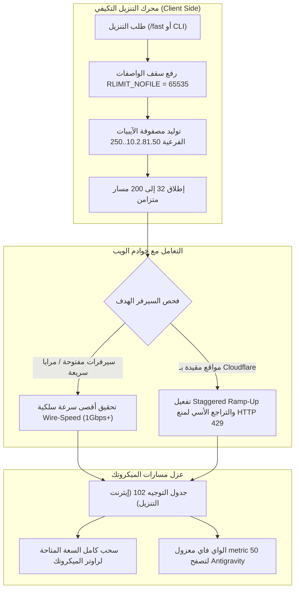
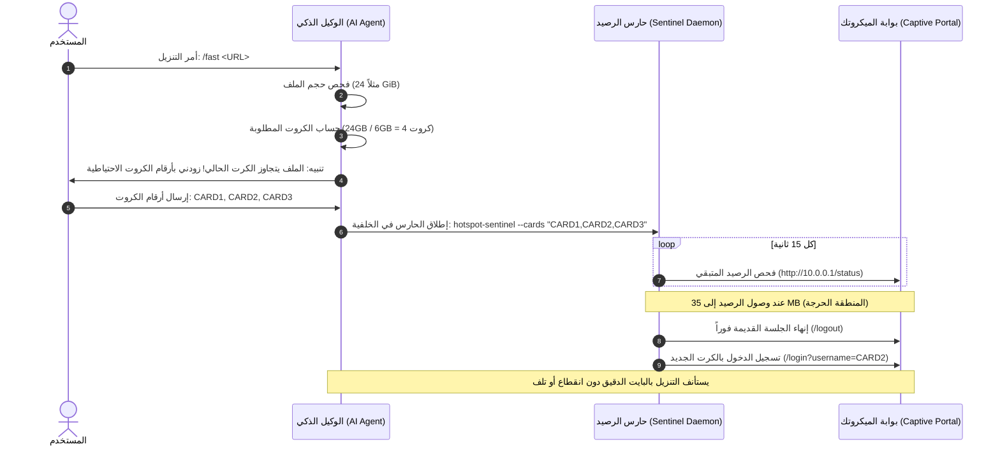

# 🚀 Hotspot-Turbo-Downloader

<div align="center">

[](https://opensource.org/licenses/Apache-2.0)
[](https://www.python.org/)
[]()
[-red.svg)](https://github.com/PMoha1)
[](https://youtube.com/@PMoha1)

**Autonomous Ultra-Fast Multi-Stream Downloader, Mikrotik Hotspot Captive Portal Manager & Quota Sentinel**  
*صُمم لكسر السرعة المحددة من الميكروتك للأجهزة وسحب أقصى سرعة ممكنة من الشبكة، وتنزيل ملفات ونماذج الذكاء الاصطناعي الضخمة بأمان تام وبدون إهدار رصيد أو انقطاع.*

</div>

---

## 📌 نبذة عن المشروع (Overview)

أداة متقدمة وهندسة برمجية متكاملة مخصصة لبيئات الشبكات المقيدة وبوابات الدخول (**Mikrotik Hotspot / Captive Portals**). تدمج الأداة بين محرك تنزيل متوازي عالي التزامن (32 إلى 200 مسار)، وحارس رصيد تلقائي ذكي، ونظام توجيه مسارات مستقل (**Policy Routing QoS**) لعزل حركة البيانات ومنع انقطاع التنزيل أثناء تنزيل النماذج أو الألعاب الضخمة حتى لو كان الكرت محدود السعة.

---

## ⚡ التثبيت الفوري لأي وكيل ذكاء اصطناعي (One-Liner Agent Install)

يمكن لأي مستخدم أو وكيل ذكاء اصطناعي (Antigravity / Hermes Agent / Claude / Cursor) تثبيت وتشغيل الأداة مباشرة بأمر واحد:

### 🐧 على أنظمة Linux & macOS:
```bash
curl -sSL https://raw.githubusercontent.com/PMoha1/Hotspot-Turbo-Downloader/main/install.sh | bash
```

### 🪟 على أنظمة Windows (PowerShell):
```powershell
irm https://raw.githubusercontent.com/PMoha1/Hotspot-Turbo-Downloader/main/install.ps1 | iex
```

> **ماذا يفعل سكربت التثبيت التلقائي؟**  
> يقوم بنسخ المستودع إلى مجلد مهارات الوكلاء القياسي (`~/.gemini/config/skills/hotspot-turbo-downloader` ومجلدات Hermes و Claude)، وإنشاء أوامر النظام المباشرة (`fast-download` و `hotspot-sentinel`) داخل مسار المستخدم لتصبح متاحة فوراً لأي وكيل أو طرفية.

---

## 🤖 تسليح أي وكيل ذكاء اصطناعي (Agent Prompt Snippet)

إذا كنت تستخدم وكيلاً خارجياً (مثل Claude Code, ChatGPT, Hermes Agent, OpenCode, Cursor)، ما عليك سوى نسخ المقطع التالي ولصقه في تعليمات الوكيل (System Prompt):

```markdown
### 🚀 Turbo Downloader Skill Integration:
- Whenever the user asks to download large files, LLM models (GGUF/SafeTensors), or bypass Mikrotik captive portals, use the pre-installed fast downloader:
  Command: `fast-download --url "<URL>" --dest "<DIR>" --streams 32 --verify-gguf`
- To monitor Mikrotik hotspot balance and auto-switch cards silently without disconnections:
  Command: `hotspot-sentinel --cards "CARD1,CARD2,CARD3"`
- Status tracking: Read `DOWNLOAD_STATUS.json` for real-time speed, bytes, and ETA.
```

---

## 💡 السياق الميداني والمشكلة الحقيقية (The Real-World Dilemma)

### 🇾🇪 معضلة شبكات الميكروتك وبطاقات الحصص المحدودة (مثال: اليمن)
في اليمن والعديد من البيئات المعتمدة على شبكات الواي فاي والميكروتك المحلية، تُباع باقات الإنترنت عبر كروت سعة محددة (مثل: كرت فئة **1000 ريال يمني** يمنح قرابة **5 إلى 6 جيجابايت**).

عند الرغبة في تنزيل ملفات عملاقة، مثل:
- نماذج الذكاء الاصطناعي مفتوحة المصدر (**LLMs / GGUF / SafeTensors**) بحجم 15GB إلى 50GB+.
- ملفات الألعاب والتحديثات الضخمة.

**المعاناة اليدوية السابقة:**
1. يضطر المستخدم للبقاء مستيقظاً ومراقبة شاشة العداد بايت ببايت خشية نفاد الكرت فجأة.
2. عند انتهاء الكرت، ينقطع التنزيل؛ وإذا حاول المستخدم إدخال الكرت الجديد يدوياً قد تفشل عملية الاستئناف أو يُعاد تنزيل أجزاء سابقة، مما يسبب إهداراً للمال والوقت.
3. قيود سرعة المشترك (Rate-Limiting) على راوترات الميكروتك تخنق الاتصال الفردي عند سرعات بطيئة (1 أو 2 ميجابت/ث).

### 🤖 الحل الجذري عبر الوكيل الذكي (Agentic AI Autonomous Execution)
تم تصميم هذه الأداة لتعمل كـ **مهارة مستقلة (Skill)** للوكلاء الأذكياء (مثل **Antigravity** و **Hermes Agent**):
- يقوم الوكيل بتشغيل حارس الرصيد ومحرك التنزيل الليلي.
- عند اقتراب الكرت من النفاد (<35MB)، يرسل الحارس تلقائياً طلب تسجيل خروج صريح (`/logout`) ثم يسجل الدخول فوراً بالكرت الاحتياطي التالي (`/login`) دون أدنى تدخل بشري.
- يستأنف المحرك التنزيل بالبايت الدقيق دون أي تكرار، ويتحقق من هيدر GGUF، ويدمج الملف نهائياً بينما يكون غطاء اللابتوب مغلقاً والمستخدم نائماً!

---

## ⚡ تحليل الأداء وسحب أقصى طاقة للشبكة (Performance Architecture)



### 1. سحب كامل سعة الميكروتك المتاحة (تجاوز خنق الجوالات إلى 50-100 ميجابت)
- **أصل السرعة في الشبكة:** تصل سرعة روترات الميكروتك ونقاط التوزيع والألياف/المايكرويف في هذه الشبكات في الأصل إلى **50 إلى 100 ميجابت/ث** أو أكثر.
- **أين يكمن القيد؟** يضع أصحاب الشبكات قيود خنق صارمة (عبر `Simple Queues` أو `PCQ`) تستهدف أجهزة الجوالات والعملاء الأفراد لتحصر كل جهاز عند **1 أو 2 ميجابت/ث** فقط لمنع استهلاك السرعة.
- **كيف تكسر الأداة هذا القيد؟**
  تقوم الأداة بتوليد مصفوفة آيبيات فرعية على نفس كرت الإيثرنت وفتح 32 إلى 200 مسار متزامن، فيتعامل الميكروتك مع كل مسار كأنه طلب مستقل، مما يؤدي إلى تجاوز سقف الجوال الفردي وسحب **كامل طاقة وسعة راوتر الميكروتك (50 إلى 100 ميجابت/ث بالكامل)**!

### 2. قيود خوادم الويب (Site Limits vs Network Limits)
- **المواقع المفتوحة (Unconstrained CDNs):** في حال عدم وجود قيود من خادم الويب، يستطيع المحرك الانطلاق بـ 100 إلى 200 مسار لملء كامل عرض النطاق الفيزيائي للبطاقة.
- **المواقع المقيدة (مثل Hugging Face المحمية بـ Cloudflare Anti-DDoS):** فتح 200 اتصال متزامن في نفس الميلي ثانية يطلق حماية Cloudflare ويعيد أخطاء `HTTP 429 Too Many Requests`. تتعامل الأداة مع هذا عبر **التدرج الزمني (Staggered Ramp-Up بفاصل 15-20ms)** والتراجع الأسي التكيفي (**Adaptive Backoff**).

### 3. مضاعفة الأداء باستخدام أكثر من كرت شبكة (Multi-NIC / Multi-Ethernet)
- **استخدام كروت متعددة:** إضافة محول إيثرنت خارجي (USB-to-Ethernet) بجانب الإيثرنت الداخلي أو شبكة الواي فاي يتيح:
  - عزل كامل بين حركة بيانات التنزيل الثقيلة وحركة النظام التفاعلية.
  - تطبيق تقنيات الـ Multi-Path لتسجيل الدخول ببطاقتين مختلفتين على مسارين فيزيائيين في آنٍ واحد، ومضاعفة السرعة الإجمالية.

---

## 🤝 كيف يطلب الوكيل الكروت ويركبها في الحارس تلقائياً؟ (Agent Card Provisioning Flow)

عند تشغيل الأداة عبر وكيل ذكي (مثل **Antigravity** أو **Hermes Agent**)، يتبع الوكيل البروتوكول الآلي التالي لطلب الكروت وإدارتها دون إزعاج المستخدم:



### 💬 حوار نموذجي بين الوكيل والمستخدم:

1. **المستخدم:**  
   > "نزل لي نموذج Qwen3.6-35B بهذا الرابط عبر مهارة التنزيل السريع، وأنا خارج بنام."
2. **الوكيل (يفحص الحجم ويحسب الاحتياج):**  
   > *"حجم النموذج هو 20.6 GiB، وهو ما يتجاوز سعة الكرت الحالي (المتبقي منه 1.4 GiB). سنحتاج إلى حوالي 3 إلى 4 كروت إضافية لضمان استمرار التنزيل طوال الليل دون توقف.*  
   > *⚡ **يُرجى تزويدي بأرقام الكروت الاحتياطية المتوفرة لديك** (مثال: `111222333, 444555666, ...`) لأقوم بتركيبها في حارس الرصيد التلقائي فوراً."*
3. **المستخدم:**  
   > `111222333, 444555666, 777888999`
4. **الوكيل (يركب الكروت ويشغل الحارس في الخلفية):**  
   - ينفذ الوكيل تلقائياً في الخلفية:
     ```bash
     hotspot-sentinel --cards "111222333,444555666,777888999" &
     fast-download --url "<URL>" --dest "~/.lmstudio/models/..." --streams 32 --verify-gguf &
     power_lock.sh &
     ```
   - يطبع الوكيل للمستخدم رسالة تأكيد:
     > *"✅ تم تسليح حارس الرصيد بـ 3 كروت احتياطية، وتم تفعيل مانع سكون اللابتوب. يمكنك إغلاق الغطاء الآن وسيتولى الوكيل تبديل الكروت ودمج النموذج تلقائياً."*

---

## 🛠️ مكونات الحزمة (Repository Structure)

| الملف | الوظيفة |
|---|---|
| **`install.sh`** / **`install.ps1`** | سكربت التثبيت التلقائي بنقرة واحدة لأنظمة Linux و Windows لربط المهارة بأي وكيل فوراً. |
| **`bin/fast-download`** | أمر الاختصار السريع لتشغيل المحرك مباشرة من أي مسار بالطرفية دون الحاجة لاستدعاء مسار بايثون الكامل. |
| **`bin/hotspot-sentinel`** | أمر الاختصار السريع لتشغيل حارس رصيد الميكروتك ومراقبة الكروت. |
| **`scripts/turbo_download.py`** | محرك التنزيل متعدد المسارات (يدعم 32 حتى 200 مسار، الاستئناف بالبايت، الدمج فائق السرعة، والتحقق من ملفات GGUF). |
| **`scripts/hotspot_sentinel.py`** | حارس الكروت التلقائي (يراقب الرصيد، يطبق قاعدة التبديل الذهبية `/logout` ثم `/login` عند بلوغ 35MB). |
| **`scripts/setup_network.sh`** | إعداد توجيه المسارات السياسية (QoS Table 102 للإيثرنت و Metric 50 للواي فاي) ومصفوفة الآيبيات الفرعية. |
| **`scripts/power_lock.sh`** | حظر الدخول في وضع السكون عند إغلاق غطاء اللابتوب لضمان التنزيل الليلي المتواصل. |
| **`scripts/windows_turbo_setup.ps1`** | سكربت ضبط الطاقة والبيئة لأنظمة Windows 11. |
| **`SKILL.md`** | تعريف المهارة القياسي للوكلاء الأذكياء (Antigravity / Hermes Agent) للاستدعاء عبر `/fast`. |

---

## 🚀 طريقة الاستخدام السريع (Quick Start)

### 💻 تشغيل الأداة مباشرة من أي مكان (Windows Run & Linux Terminal)

#### 🪟 على نظام Windows:
1. **التثبيت التلقائي للـ PATH:** بمجرد تشغيل أمر التثبيت بـ PowerShell:
   ```powershell
   irm https://raw.githubusercontent.com/PMoha1/Hotspot-Turbo-Downloader/main/install.ps1 | iex
   ```
   يقوم السكربت تلقائياً بإضافة مسار الأداة (`bin`) إلى متغيرات البيئة للمستخدم (`User PATH`).
2. **التشغيل المباشر من نافذة Run أو الطرفية:**
   - اضغط `Win + R` واكتب الأمر مباشرة، أو افتح أي نافذة (CMD / PowerShell) في أي مسار واكتب:
     ```cmd
     fast-download --url "https://example.com/model.gguf"
     ```
   - ولتشغيل حارس الكروت التلقائي:
     ```cmd
     hotspot-sentinel --cards "CARD1,CARD2,CARD3"
     ```
   *(إذا قمت بتنزيل المشروع يدوياً دون سكربت التثبيت: فقط انسخ المسار الكامل لمجلد `bin` وضعه في متغيرات النظام `Environment Variables -> Path`).*

#### 🐧 على نظام Linux:
- يتم ربط الأداة تلقائياً في `~/.local/bin/`. افتح أي طرفية (Terminal) واكتب مباشرة:
  ```bash
  fast-download --url "https://example.com/model.gguf" --dest "/path/to/models"
  ```

---

### 🌐 إعداد الشبكة ومصفوفة العناوين (Linux Advanced):
```bash
# إنشاء مصفوفة 32 عنوان IP وعزل مسار الإيثرنت
sudo ./scripts/setup_network.sh 32

# أو إنشاء مصفوفة موسعة حتى 200 عنوان IP للسرعات العالية:
sudo ./scripts/setup_network.sh 200
```

### 2. تشغيل حارس الكروت الاحتياطية (Sentinel):
```bash
python3 scripts/hotspot_sentinel.py --cards "CARD_USER_1,CARD_USER_2,CARD_USER_3"
```

### 3. إطلاق التنزيل التوربو (Multi-Stream Download):
```bash
# التنزيل التكيفي (32 مسار - موصى به لمواقع مثل Hugging Face)
python3 scripts/turbo_download.py \
    --url "https://example.com/model.gguf" \
    --dest "/path/to/models" \
    --streams 32 \
    --chunks 64 \
    --verify-gguf

# التنزيل عالي الكثافة للمرايا المفتوحة (100 مسار)
python3 scripts/turbo_download.py \
    --url "https://fast-mirror.com/file.bin" \
    --dest "/path/to/downloads" \
    --streams 100 \
    --chunks 200 \
    --interfaces "10.2.81.50-250"
```

### 4. التشغيل عبر الوكيل الذكي (Antigravity):
بمجرد تثبيت المهارة، يمكنك التحدث للوكيل مباشرة:
> "استخدم مهارة التنزيل السريع لتنزيل الرابط التالي..."  
> أو كتابة: `/fast <URL>`

---

## 📜 الترخيص وحقوق الملكية (License & Copyright)

هذا المشروع مرخص بموجب **Apache License 2.0**.

- يحق لأي مبرمج أو مهندس استخدام الكود، تطويره، تعديله، أو البناء عليه بحرية كاملة.
- **شرط صريح:** يمنع منعاً باتاً نزع حقوق الملكية الأصلية أو نسب العمل لغير صاحبه، ويجب الإبقاء على إشعار حقوق الملكية ورابط المشروع الأصلي في أي نسخة أو تعديل مشتق.

**Copyright (c) 2026 Mohammed Yaqeen (PMoha1). All Rights Reserved.**
